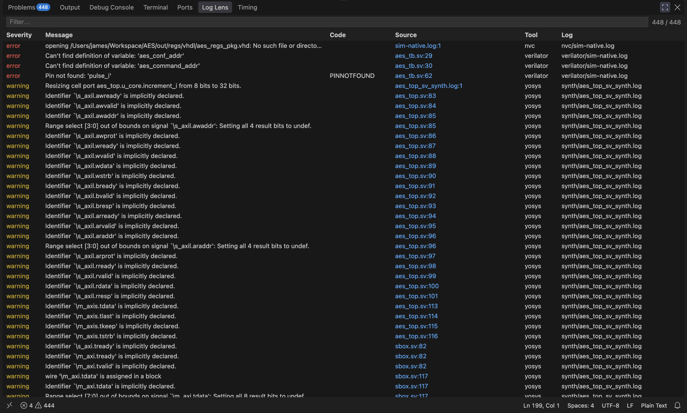
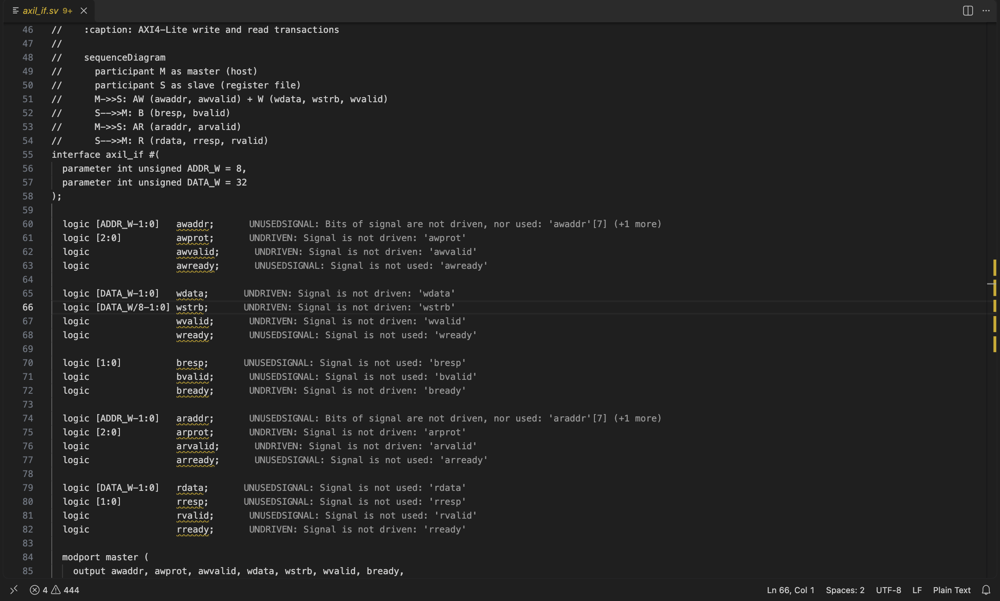
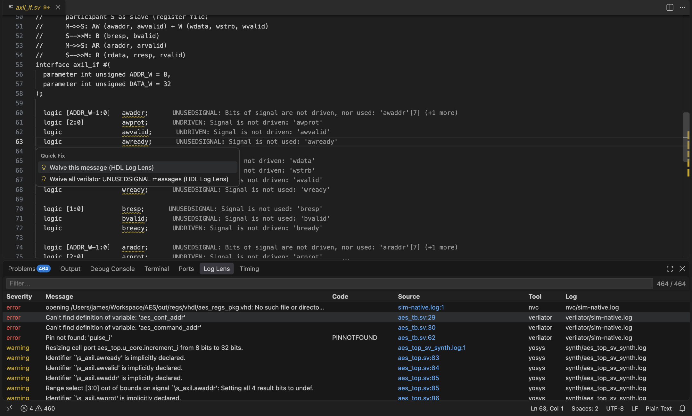
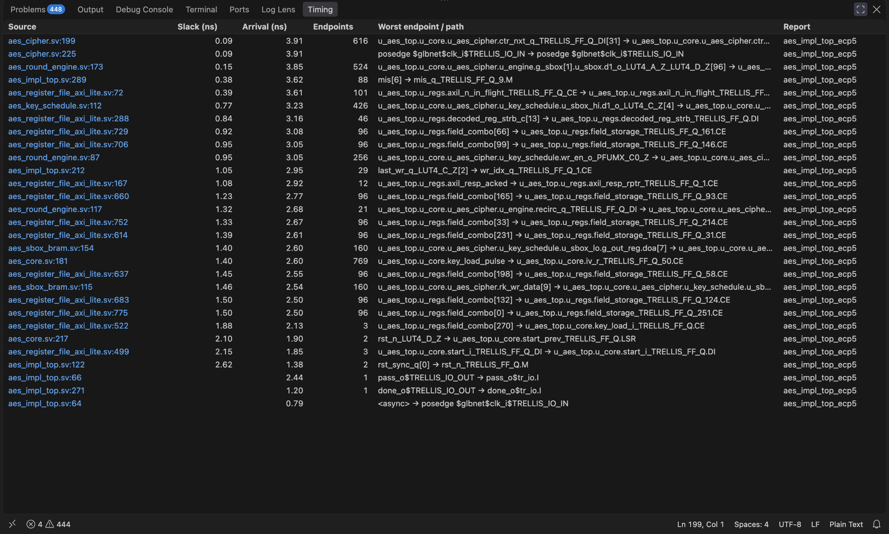
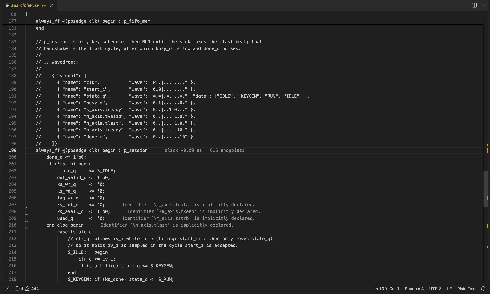
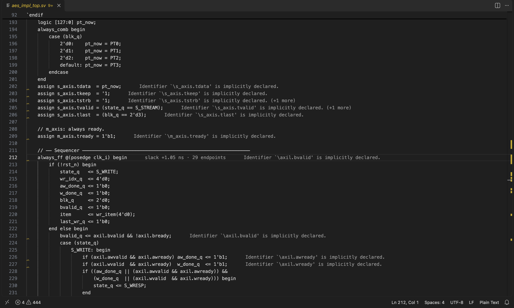

# HDL-Log-Lens

Turn HDL tool logs into clickable VS Code problems — NVC, Verilator, Yosys, nextpnr, Vivado, Questa.

_Implemented today: **Verilator, NVC, Yosys, nextpnr**. Vivado and Questa will be added once they can be tested against real logs._

A VS Code extension that reads the log and report files your HDL tools leave on disk and puts what matters next to your code:

- [**Log Lens table**](#log-lens-table): every warning and error from every log in one sortable, filterable table; click to jump to the line.
- [**Inline problem messages**](#inline-problem-messages): the message at the end of the offending line, styled like git blame.
- [**Waivers**](#waivers): hide reviewed messages (one message, or a whole message type) with a quick fix or a right-click, kept in a file you can commit.
- [**Timing table**](#timing-table) and [**inline timing**](#inline-timing): which source lines limit timing, with slack, from your nextpnr reports.
- The same problems also appear in VS Code's own **Problems** panel.

## Install

Not on the Marketplace yet; install the packaged extension (VS Code 1.90 or newer):

```
npm install
npm run build
npx @vscode/vsce package --no-dependencies
code --install-extension hdl-log-lens-0.0.1.vsix
```

If `code` isn't on your PATH, use the Extensions view → `…` menu → **Install from VSIX…** instead. Then run **Developer: Reload Window**. The extension starts with VS Code and logs what it does to the **HDL Log Lens** Output channel (which logs it found, how many problems, why a log was skipped).

## Getting logs for it to read

The extension reads files; it doesn't run your tools. Save each tool's output where `hdlLogLens.logGlobs` can find it (default `**/out/reports/**/*.log` and `**/*.rpt`). Any way of saving works, for example:

```
verilator --lint-only ... > out/reports/verilator/lint.log 2>&1
nvc -a ... > out/reports/nvc/sim.log 2>&1
yosys ... -l out/reports/yosys/yosys.log
nextpnr-ecp5 ... -l out/reports/yosys/nextpnr.log
```

The tool is detected from the file name or its parent folder (`verilator/`, `nvc/`, `yosys/`, `nextpnr`), then from the log's contents; set `hdlLogLens.tool` to force one parser.

For the [Timing table](#timing-table), also have nextpnr write its report and routed netlist next to each other: `--report out/reports/impl/<name>_timing.json --detailed-timing-report --write out/reports/impl/<name>_routed.json`.

## How it works

- Finds logs with `hdlLogLens.logGlobs` and re-parses a log whenever it changes, replacing that log's previous problems.
- Resolves source paths: absolute → relative to the log → workspace root → unique filename match. If no single file matches, the problem is attached to the log itself with the original `file:line` in the message.
- Identical problems within one log appear once (Yosys repeats warnings). Problems from different logs are kept separate.
- `source` is the tool name, `code` the tool's message ID (e.g. `UNUSEDSIGNAL`).
- nextpnr messages have no location, so they attach to the log file.

## Log Lens table



A **Log Lens** tab in the bottom panel (next to Problems and Timing) lists every problem as a table: **Severity**, **Message**, **Code**, **Source** (`file:line`), **Tool** and **Log**. Errors come first, then by file and line. Click a column header to re-sort, type in the filter box to narrow the rows, click a row (or press Enter) to open the line. Sort and filter survive refreshes. The tab title shows the problem and waived counts.

## Inline problem messages



Each source line with a problem also shows its message at the end of the line in the same muted style as VS Code's git blame (the editor font, the `editorInlayHint.foreground` colour, a 50 px gap; the squiggle and gutter still carry severity): `UNUSEDSIGNAL: Signal is not used: 'awready'`. A line with several problems shows the worst one plus `(+N more)`; identical messages from different logs count once; long messages are cut at 120 characters. Messages attached to a log file instead of a source line (nextpnr, some NVC) are not shown, and neither are waived ones. Toggle with **HDL Log Lens: Toggle inline problem messages** or `hdlLogLens.inlineProblems`.

## Waivers



Hide messages you've reviewed and accepted. Waivers live in `hdl-log-lens.waivers.json` in your first workspace folder (setting `hdlLogLens.waiverFile`), so they can be committed and reviewed:

```json
{ "waivers": [
  { "tool": "verilator", "code": "UNUSEDSIGNAL", "reason": "spare bus bits" },
  { "tool": "yosys", "file": "src/sbox.sv", "message": "wire '\\m_axi.tdata' is assigned in a block", "reason": "AXI-S interface" }
] }
```

A waiver hides every message that matches **all** the fields it lists (`tool`, `code`, `file` relative to the workspace, `message` text); there are no line numbers, so waivers survive edits. A waiver must list at least one field.

- **Quick fix** (lightbulb, or Cmd+.) on a problem in the editor: *Waive this message* (tool + code + file + text) or *Waive all messages of this type* (tool + code; tool + text when the tool gives no code).
- **Right-click** a row in the Log Lens table offers the same two choices. VS Code gives extensions no right-click menu on its own Problems panel.
- You're asked for an optional reason, which is saved in the file. To undo, delete the entry (or **HDL Log Lens: Open waiver file**).
- Waived messages are hidden, counted in the Log Lens tab title and listed in the HDL Log Lens Output channel. An invalid waiver file waives nothing and is never overwritten.

## Timing table



A **Timing** tab in the bottom panel (next to Problems) lists the source lines that limit your timing, **one row per line**, worst slack first. It reads nextpnr timing reports (`hdlLogLens.timingGlobs`, default `**/out/reports/**/*_timing.json`) and needs the sibling `<name>_routed.json`, whose cells carry the HDL line they came from (see [Getting logs](#getting-logs-for-it-to-read)).

Columns: **Source** (`file:line`), **Slack** (of the worst path or register input through the line: clock period minus its arrival time), **Arrival**, **Endpoints** (register inputs ending on the line; a whole bus collapses into one row), **Worst endpoint / path**, **Report**. Click a column header to re-sort; click a row (or press Enter) to open the line. `hdlLogLens.worstLines` (default 200) caps the number of lines.

A register's source line is usually the start of its `always_ff` block. Lines are included only if they trace to your code, so delay in tool-library cells and endpoints with no source line are left out. Lines touched only by unconstrained (async) paths have no slack. There is no TNS: nextpnr doesn't report it.

## Inline timing



Lines that appear in the timing table also get a muted note at the end of the line in the editor: `slack +0.09 ns · 616 endpoints` (red when slack is negative). Toggle with **HDL Log Lens: Toggle inline timing** or `hdlLogLens.inlineTiming`. The note matches the editor's file by exact path and is not moved when you edit the file, so it can go stale until the next report. It uses the same style as the problem messages, and a line with both shows the two side by side:



## Settings & commands

| Setting | |
|---|---|
| `hdlLogLens.logGlobs` | log/report globs to parse (default `**/out/reports/**/*.log`, `**/*.rpt`) |
| `hdlLogLens.tool` | `auto`, or force one parser (`verilator`, `yosys`, `nextpnr`, `nvc`) |
| `hdlLogLens.suppressCodes` | message IDs to hide everywhere |
| `hdlLogLens.waiverFile` | waiver file path (default `hdl-log-lens.waivers.json`) |
| `hdlLogLens.timingGlobs` | nextpnr timing reports for the Timing table |
| `hdlLogLens.worstLines` | how many source lines the Timing table lists (default 200) |
| `hdlLogLens.inlineProblems` | show each line's worst problem at the end of the line (default on) |
| `hdlLogLens.inlineTiming` | show slack at the end of timing-critical lines (default on) |

| Command | |
|---|---|
| **HDL Log Lens: Clear HDL problems** | empties the panels until a log changes again |
| **HDL Log Lens: Open waiver file** | opens `hdl-log-lens.waivers.json` |
| **HDL Log Lens: Toggle inline problem messages** | turns the end-of-line messages on or off |
| **HDL Log Lens: Toggle inline timing** | turns the end-of-line slack notes on or off |

## Known limits

- Problems and inline notes don't move or clear when you edit the source; they refresh when the log or report is next written.
- Vivado and Questa logs are not supported yet. Timing needs nextpnr reports.
- Windows/WSL paths are handled only for drive-letter paths in Verilator logs and filename search.
- NVC parsing is tested on compile errors and a fatal; NVC *runtime* simulation messages (assertions etc.) are not yet tested against real logs.

## Development

```
npm install
npm test                                   # unit tests, real AES log fixtures
AES_DIR=/path/to/AES npm run test:integration   # runs in a real VS Code host (macOS app path; set VSCODE_BIN elsewhere)
```

Fixtures in `test/fixtures` come from the AES project's `out/reports`.

The screenshots in `docs/images` are real VS Code captures of the extension running on AES; regenerate them with `AES_DIR=/path/to/AES node scripts/screenshots/driver.js` (macOS; a VS Code window opens for about 30 seconds).
